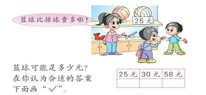

# Mathematics (Grade 6)

**ID**: bbe09a08
**难度**: medium_easy
**题型**: fill_in_the_blank

## 题目

## 解答

**答案**: 58

1. Step1:已知排球价格是25元，题目说篮球比排球贵多啦。
2. Step2:分析25元与排球价格相同，不符合贵多啦的条件；30元只比25元贵5元，不属于贵多啦；58元比25元贵很多，符合条件。
3. Step3:所以篮球价格是58元。

## 知识点

**知识点**:
  - 小学数学;数与代数;数的认识;整数的认识

---
