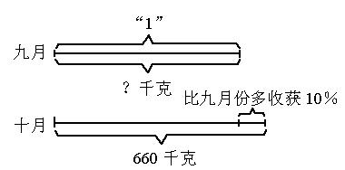

# Mathematics (Grade 6)

**ID**: c03a58e6
**难度**: medium_easy
**题型**: fill_in_the_blank

## 题目
张伯伯的鸡厂十月份收获鸡蛋660千克，比九月份多收获了10％．九月份收获鸡蛋________  

## 解答

**答案**: 600千克

1. Step1:把九月份收获鸡蛋的重量看作单位'1'，十月份比九月份多收获10％，那么十月份收获鸡蛋的重量是九月份的(1 + 10％) = 110％
2. Step2:已知十月份收获鸡蛋660千克，根据已知一个数的百分之几是多少，求这个数用除法，所以用十月份收获鸡蛋的重量除以它对应的百分数，即660÷110％
3. Step3:计算660÷110％ = 660÷1.1 = 600千克，得到九月份收获鸡蛋的重量

## 知识点

**知识点**:
  - 小学数学;数与代数;应用题;常见的数学问题;图文问题

---
