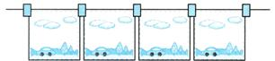

# Mathematics (Grade 6)

**ID**: c05993e7
**难度**: medium_easy
**题型**: fill_in_the_blank

## 题目
像这样晒手帕，晒9块手帕需要（______）个夹子；9个夹子可以晒这样的（______）块手帕。

## 解答

**答案**: 10, 8

1. Step1:观察可知，两块手帕相邻时，相邻处共用一个夹子，夹子数比手帕数多1。所以晒9块手帕时，夹子数为9 + 1 = 10个。
2. Step2:已知夹子数比手帕数多1，那么当有9个夹子时，手帕数为9 - 1 = 8块。

## 知识点

**知识点**:
  - 小学数学;探索规律;通过操作实验探索规律

---
