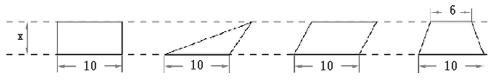

# Mathematics (Grade 6)

**ID**: e9f3a286
**难度**: medium_easy
**题型**: fill_in_the_blank

## 题目
如下图，图（_____）与图（_____）的面积相等，图（____）的面积是图（_____）的2倍。

## 解答

**答案**: 1, 3, 1、3, 2

1. Step1:根据图形面积公式，长方形面积 = 长×宽，三角形面积 = 底×高÷2，平行四边形面积 = 底×高，梯形面积 = （上底 + 下底）×高÷2。设高都为x。
2. Step2:计算长方形面积，长为10，高为x，面积为10x。
3. Step3:计算三角形面积，底为10，高为x，面积为10x÷2 = 5x。
4. Step4:计算平行四边形面积，底为10，高为x，面积为10x。
5. Step5:计算梯形面积，上底为6，下底为10，高为x，面积为(6 + 10)x÷2 = 8x。
6. Step6:对比面积可知，长方形（图1）和平行四边形（图3）面积相等，都为10x。
7. Step7:长方形（图1）和平行四边形（图3）的面积10x是三角形（图2）面积5x的2倍。
8. Step8:得出图（1）与图（3）的面积相等，图（1、3）的面积是图（2）的2倍。

## 知识点

**知识点**:
  - 小学数学;图形与几何;平面图形;平行四边形;平行四边形的面积;梯形的特征及分类;梯形的面积;三角形;三角形的面积

---
