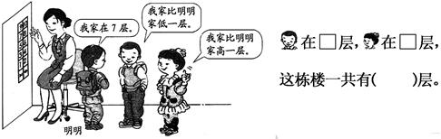

# Mathematics (Grade 6)

**ID**: f5bbfa24
**难度**: medium_easy
**题型**: fill_in_the_blank

## 题目

## 解答

**答案**: 6, 8, 10

1. Step1:已知明明家在7层，一个小朋友说自己家比明明家低一层，那么这个小朋友家所在楼层为7 - 1 = 6层
2. Step2:另一个小朋友说自己家比明明家高一层，那么这个小朋友家所在楼层为7 + 1 = 8层
3. Step3:从图中可知楼层标识到10层，所以这栋楼一共有10层
4. Step4:将前面得到的楼层数按顺序整理为['6', '8', '10']

## 知识点

**知识点**:
  - 

---
