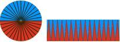

# Mathematics (Grade 6)

**ID**: f6176384
**难度**: medium_easy
**题型**: fill_in_the_blank

## 题目
把一个直径是3厘米的圆分成若干等分，然后把它剪开，照图的样子拼起来，拼成的图形的周长是（______）厘米．

## 解答

**答案**: 12.42

1. Step1:明确拼成的图形的周长与圆的关系，拼成的图形的周长比圆的周长多了圆的两个半径，也就是一个直径的长度。
2. Step2:根据圆的周长公式C = πd（其中C表示圆的周长，d表示圆的直径，π通常取3.14），计算圆的周长，即3.14×3 = 9.42厘米。
3. Step3:计算拼成图形的周长，圆的周长9.42厘米加上圆的直径3厘米，9.42 + 3 = 12.42厘米。

## 知识点

**知识点**:
  - 小学数学;图形与几何;平面图形;长方形和正方形;长方形的周长;圆;圆的周长

---
