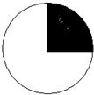

# Mathematics (Grade 6)

**ID**: 2c867998
**难度**: medium_easy
**题型**: multiple_choice

## 题目
如图圆的半径是5厘米，阴影部分的周长是（  ）厘米．
A．7.85
B．17.85
C．12.85
D．41.4

## 解答

**答案**: B

1. Step1:明确阴影部分周长的组成，根据图意可知阴影部分的周长=2r+$rac{1}{4}$×圆的周长
2. Step2:已知圆的半径r = 5厘米，根据圆的周长公式C = 2πr，可计算出圆的周长为2×3.14×5
3. Step3:计算$rac{1}{4}$×圆的周长，即$rac{1}{4}$×2×3.14×5 = 7.85厘米
4. Step4:计算2r，即2×5 = 10厘米
5. Step5:计算阴影部分的周长，即10 + 7.85 = 17.85厘米
6. Step6:从选项中找出对应的答案为B

## 知识点

**知识点**:
  - 圆、圆环的周长．

---
