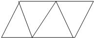

# Mathematics (Grade 6)

**ID**: 32d6233f
**难度**: medium_easy
**题型**: multiple_choice

## 题目
图中有（  ）个大小不同的平行四边形．
A．4
B．6
C．9
D．5、

## 解答

**答案**: A

1. Step1:根据解析2，明确要分类数平行四边形，分为单个的和平行四边形组合的两类
2. Step2:根据解析1，数出单个的平行四边形有3个
3. Step3:根据解析1，数出由两个平行四边形组成的平行四边形有1个
4. Step4:将单个的和平行四边形组合的数量相加，3 + 1 = 4，得出图中平行四边形的总数
5. Step5:对比选项，答案是A

## 知识点

**知识点**:
  - 平行四边形的特征及性质；组合图形的计数．

---
