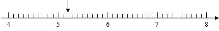

# Mathematics (Grade 6)

**ID**: 47dc17d4
**难度**: medium_easy
**题型**: multiple_choice

## 题目
下图中箭头所指的位置用小数表示是（）。 

A.0.2
B.5.2
C.5.6
D.6.8

## 解答

**答案**: B

1. Step1:观察图形可知直线上一大格表示1
2. Step2:发现一大格被平均分成10小格，由此推出一小格表示0.1
3. Step3:看到箭头所指的位置在5的右边2小格处
4. Step4:计算得出该位置用小数表示是5 + 0.1×2 = 5.2
5. Step5:对比选项，确定答案为B

## 知识点

**知识点**:
  - 

---
