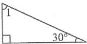

# Mathematics (Grade 6)

**ID**: 518667d3
**难度**: medium_easy
**题型**: multiple_choice

## 题目
如图中的∠1=（  ）

A．50°
B．60°
C．75°

## 解答

**答案**: B

1. Step1:根据解析2可知，直角三角形中两个锐角和是90度
2. Step2:图中已知一个锐角是30度，另一个锐角为∠1
3. Step3:用两个锐角的和90度减去已知锐角30度，即90 - 30 = 60度，得到∠1的度数为60度
4. Step4:对比选项，60度对应的是B选项

## 知识点

**知识点**:
  - 角的度量；三角形的内角和．

---
