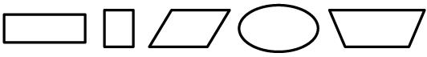

# Mathematics (Grade 6)

**ID**: 5a26d71e
**难度**: medium_easy
**题型**: multiple_choice

## 题目
下列图形中是轴对称图形的有（）个。 

A.2个
B.3个
C.4个
D.5个

## 解答

**答案**: C

1. Step1:明确轴对称图形的定义为一个图形沿一条直线对折，直线两旁的图形完全重合，折痕所在直线为对称轴
2. Step2:分析第一个图形长方形，沿其长或宽的中线对折，直线两旁图形完全重合，是轴对称图形
3. Step3:分析第二个图形正方形，沿其对边中线或对角线对折，直线两旁图形完全重合，是轴对称图形
4. Step4:分析第三个图形平行四边形，无论沿哪条直线对折，直线两旁图形都无法完全重合，不是轴对称图形
5. Step5:分析第四个图形椭圆，沿其长轴或短轴对折，直线两旁图形完全重合，是轴对称图形
6. Step6:分析第五个图形梯形，当它是等腰梯形时，沿其上下底中点连线对折，直线两旁图形完全重合，是轴对称图形
7. Step7:统计轴对称图形个数为长方形、正方形、椭圆、等腰梯形，共4个
8. Step8:得出答案为C

## 知识点

**知识点**:
  - 

---
