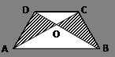

# Mathematics (Grade 6)

**ID**: 691196ef
**难度**: medium_easy
**题型**: multiple_choice

## 题目
梯形ABCD中，三角形AOD和三角形BOC的面积相比，(   )大．

A 三角形AOD B 三角形BOC 
C 同样多    D 无法比较

## 解答

**答案**: D

1. Step1:根据梯形的性质，仅知道ABCD是梯形，没有给出关于梯形各边长度、高以及三角形AOD和三角形BOC的任何具体边长、高或角度等相关信息
2. Step2:由于缺乏这些关键信息，无法通过面积公式等方法直接计算出三角形AOD和三角形BOC的面积
3. Step3:也没有足够条件进行间接的面积比较推理
4. Step4:所以无法比较三角形AOD和三角形BOC面积的大小，答案为D

## 知识点

**知识点**:
  - 

---
