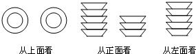

# Mathematics (Grade 6)

**ID**: 9d62a3e7
**难度**: medium_easy
**题型**: multiple_choice

## 题目
桌子上摆0若干个碟子，从手个方向看r图所示，则这张桌子上共有碟子（  ）
A．6个
B．8个
C．12个

## 解答

**答案**: B

1. Step1:根据从上面看的图形可知碟子有两行
2. Step2:由从正面看的图形可知左边一行有5个碟子
3. Step3:从正面看的图形还可知右边一行有3个碟子
4. Step4:计算碟子总数，5 + 3 = 8个
5. Step5:对比选项，答案是B

## 知识点

**知识点**:
  - 从不同方向观察物体和几何体．

---
