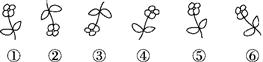

# Mathematics (Grade 6)

**ID**: b8aa1bb9
**难度**: medium_easy
**题型**: multiple_choice

## 题目
下面图形中，图形(  )是由图形①平移得到的．

## 解答

**答案**: ⑤

1. Step1:明确平移的概念，平移是指在平面内，将一个图形上的所有点都按照某个方向作相同距离的移动，平移不改变图形的形状、大小和方向。
2. Step2:观察图形①以及其他图形，逐一对比形状、大小和方向。
3. Step3:发现图形⑤的形状、大小和方向与图形①完全一致，所以图形⑤是由图形①平移得到的。

## 知识点

**知识点**:
  - 

---
