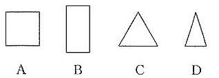

# Mathematics (Grade 6)

**ID**: bb6a079a
**难度**: medium_easy
**题型**: multiple_choice

## 题目
下面轴对称图形中，对称轴最多的是（    ）。

## 解答

**答案**: A

1. Step1:明确A是正方形，其对称轴有4条
2. Step2:明确B是长方形，其对称轴有2条
3. Step3:明确C是等边三角形，其对称轴有3条
4. Step4:明确D是等腰三角形，其对称轴有1条
5. Step5:比较4、2、3、1的大小，4最大，所以对称轴最多的是A

## 知识点

**知识点**:
  - 第7单元测试题;

---
