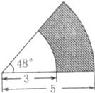

# Mathematics (Grade 6)

**ID**: c72717a8
**难度**: medium_easy
**题型**: multiple_choice

## 题目
如图所示，求阴影部分面积列式正确的是（  ）

A．$\frac{48π×3^{2}}{360}$
B．$\frac{48π(5^{2}−3^{2})}{360}$
C．$\frac{48π(5−3)^{2}}{360}$
D．$\frac{48π(8^{2}−3^{2})}{360}$

## 解答

**答案**: B

1. Step1:明确扇形面积公式为$S = \pi r^{2}×rac{n}{360}$，其中$r$为扇形半径，$n$为圆心角度数。
2. Step2:确定大扇形半径为5，圆心角为48°，根据公式可得大扇形面积为$\pi×5^{2}×rac{48}{360}$。
3. Step3:确定小扇形半径为3，圆心角为48°，根据公式可得小扇形面积为$\pi×3^{2}×rac{48}{360}$。
4. Step4:求阴影部分面积，用大扇形面积减去小扇形面积，即$\pi×5^{2}×rac{48}{360} - \pi×3^{2}×rac{48}{360}$。
5. Step5:对$\pi×5^{2}×rac{48}{360} - \pi×3^{2}×rac{48}{360}$进行化简，得到$rac{48\pi(5^{2} - 3^{2})}{360}$。

## 知识点

**知识点**:
  - 圆、圆环的面积．

---
