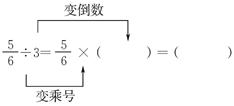

# Mathematics (Grade 6)

**ID**: e46ce2a5
**难度**: medium_easy
**题型**: multiple_choice

## 题目

分数除以不为0的整数等于分数乘这个整数的(   )。

## 解答

**答案**: C

1. Step1:根据分数除法的运算法则，分数除以不为0的整数等于分数乘这个整数的倒数
2. Step2:所以括号内应填倒数

## 知识点

**知识点**:
  - 

---
