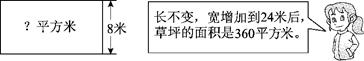

# Mathematics (Grade 6)

**ID**: 0aeec301
**难度**: medium_easy
**题型**: short_answer

## 题目
原来草坪的面积是多少？

## 解答

**答案**: 120

1. Step1:根据宽增加到24米后面积是360平方米，以及原来宽为8米，先计算宽的变化倍数，即24÷8 = 3
2. Step2:因为长不变，面积与宽成正比，所以用变化后的面积360平方米除以宽的变化倍数3，得到原来草坪的面积，即360÷3 = 120平方米

## 知识点

**知识点**:
  - 小学数学;数与代数;数的运算;整数的四则运算

---
