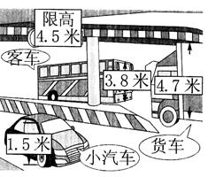

# Mathematics (Grade 6)

**ID**: 18d53cd6
**难度**: medium_easy
**题型**: short_answer

## 题目
哪些车能从桥下经过？为什么？

## 解答

**答案**: 小汽车, 客车

1. Step1:已知限高4.5米，判断车辆能否通过需比较车辆高度与限高的大小关系
2. Step2:小汽车高度为1.5米，因为1.5米小于4.5米，所以小汽车能从桥下经过
3. Step3:客车高度为3.8米，由于3.8米小于4.5米，所以客车能从桥下经过
4. Step4:货车高度为4.7米，4.7米大于4.5米，所以货车不能从桥下经过
5. Step5:综上，能从桥下经过的车是小汽车和客车

## 知识点

**知识点**:
  - 小学数学;数与代数;数的认识;小数的认识

---
