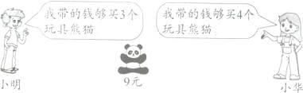

# Mathematics (Grade 6)

**ID**: 1d9d2e9e
**难度**: medium_easy
**题型**: short_answer

## 题目
小明比小华少带多少钱?

## 解答

**答案**: 9元

1. Step1:先求出小华比小明多买玩具熊猫的数量，即4 - 3 = 1个
2. Step2:已知每个玩具熊猫9元，用多买的数量乘以每个玩具熊猫的价格，即1×9 = 9元，得到小明比小华少带的钱数

## 知识点

**知识点**:
  - 小学数学;数与代数;应用题;简单应用题;整数简单应用题

---
