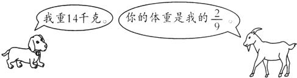

# Mathematics (Grade 6)

**ID**: 233de69f
**难度**: medium_easy
**题型**: short_answer

## 题目

山羊重多少千克？

## 解答

**答案**: 63

1. Step1:明确把山羊的重量看作单位‘1’
2. Step2:已知小狗重14千克，且小狗的体重是山羊的$rac{2}{9}$，单位‘1’（山羊体重）未知
3. Step3:根据已知一个数的几分之几是多少，求这个数用除法，所以用14除以$rac{2}{9}$来计算山羊的体重
4. Step4:计算14÷$rac{2}{9}$=63千克

## 知识点

**知识点**:
  - 分数除法应用题．

---
