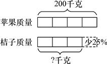

# Mathematics (Grade 6)

**ID**: 302df9d9
**难度**: medium_easy
**题型**: short_answer

## 题目
看图列式计算，不写答句。

## 解答

**答案**: 150

1. Step1:分析可知桔子质量比苹果质量少25%，把苹果质量看作单位'1'，则桔子质量是苹果质量的1 - 25%
2. Step2:已知苹果质量为200千克，求桔子质量，用苹果质量乘以桔子质量占苹果质量的比例，即200×(1 - 25%)
3. Step3:计算200×(1 - 25%) = 200×0.75 = 150千克

## 知识点

**知识点**:
  - 小学数学;数与代数;应用题;常见的数学问题;图文问题

---
