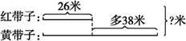

# Mathematics (Grade 6)

**ID**: 3713d2b2
**难度**: medium_easy
**题型**: short_answer

## 题目
看图列式解答。

## 解答

**答案**: 90(米)

1. Step1:观察图可知红带子长26米，黄带子比红带子长38米，所以黄带子的长度为26 + 38米
2. Step2:要求红带子和黄带子一共的长度，需将红带子长度与黄带子长度相加，即(26 + 38)+26米
3. Step3:计算(26 + 38)+26 = 90米

## 知识点

**知识点**:
  - 小学数学;数与代数;应用题;常见的数学问题;图文问题

---
