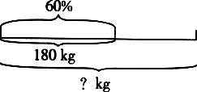

# Mathematics (Grade 6)

**ID**: 47e0d07a
**难度**: medium_easy
**题型**: short_answer

## 题目
看图列式计算。

## 解答

**答案**: 300(kg)

1. Step1:观察图形可知，180kg对应的是总量的60%
2. Step2:根据已知部分量和其对应的百分比求总量，用除法计算，即总量 = 部分量÷对应的百分比
3. Step3:已知部分量为180kg，对应的百分比为60%，所以总量为180÷60% = 300(kg)

## 知识点

**知识点**:
  - 小学数学;数与代数;数的运算;百分数的四则运算;应用题;常见的数学问题;图文问题

---
