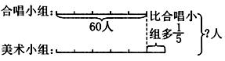

# Mathematics (Grade 6)

**ID**: 4d7f4e3a
**难度**: medium_easy
**题型**: short_answer

## 题目
看图列式计算

## 解答

**答案**: 132

1. Step1:先求出美术小组的人数，因为美术小组比合唱小组多$\frac{1}{5}$，合唱小组有60人，所以美术小组人数为60×(1 + $\frac{1}{5}$ = 72人
2. Step2:再求合唱小组和美术小组的总人数，即美术小组人数72人加上合唱小组人数60人，72 + 60 = 132人

## 知识点

**知识点**:
  - 小学数学;数与代数;数的运算;分数的四则运算;分数的四则混合运算

---
