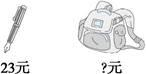

# Mathematics (Grade 6)

**ID**: 4de277e2
**难度**: medium_easy
**题型**: short_answer

## 题目

书包的价钱比钢笔的4倍还多3元。一个书包多少元?

## 解答

**答案**: 95

1. Step1:明确钢笔价格为23元
2. Step2:计算钢笔价格的4倍，即23×4
3. Step3:在此基础上再加上3元，即23×4 + 3
4. Step4:得出结果为95元

## 知识点

**知识点**:
  - 小学数学;数与代数;应用题;简单应用题

---
