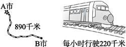

# Mathematics (Grade 6)

**ID**: 548f80cb
**难度**: medium_easy
**题型**: short_answer

## 题目
小刚从A市出发坐火车去B市旅游,4小时能到达吗?

## 解答

**答案**: 不能到达

1. Step1:计算火车4小时行驶的路程，根据速度×时间=路程，火车速度是每小时220千米，时间是4小时，即220×4=880千米
2. Step2:比较火车4小时行驶的路程880千米和A市到B市的距离890千米的大小，880<890
3. Step3:根据比较结果得出结论，因为880小于890，所以4小时不能到达

## 知识点

**知识点**:
  - 小学数学;数与代数;应用题;常见的数学问题;行程问题

---
