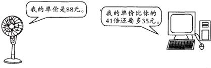

# Mathematics (Grade 6)

**ID**: 86cb637a
**难度**: medium_easy
**题型**: short_answer

## 题目
买一台电脑要多少元？

## 解答

**答案**: 3643

1. Step1:明确电脑单价与风扇单价的关系，即电脑单价比风扇单价88元的41倍还多35元
2. Step2:先计算风扇单价88元的41倍，即88×41=3608
3. Step3:再计算比88×41的结果多35的数，即3608+35=3643，此结果就是电脑的单价

## 知识点

**知识点**:
  - 整数、小数复合应用题．

---
