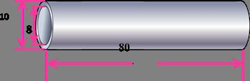

# Mathematics (Grade 6)

**ID**: 88e6c97d
**难度**: medium_easy
**题型**: short_answer

## 题目
求下面物体的体积。（单位：厘米）

## 解答

**答案**: 2260.8

1. Step1:根据圆柱体积公式V = π×(R² - r²)×h，其中外半径R = 10÷2 = 5厘米，内半径r = 8÷2 = 4厘米，高h = 80厘米
2. Step2:计算R² - r²，即5² - 4² = 25 - 16 = 9
3. Step3:计算体积V = 3.14×9×80 = 2260.8立方厘米

## 知识点

**知识点**:
  - 

---
