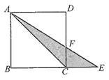

# Mathematics (Grade 6)

**ID**: 9ec7c5f1
**难度**: medium_easy
**题型**: short_answer

## 题目
如图所示，ABCD是边长为8厘米的正方形，三角形ADF的面积比三角形CEF的面积大10平方厘米，求阴影部分的面积。

## 解答

**答案**: 22平方厘米

1. Step1:因为三角形ADF的面积比三角形CEF的面积大10平方厘米，所以三角形ADF与三角形ACF的面积和比三角形CEF与三角形ACF的面积和大10平方厘米。
2. Step2:三角形ADF与三角形ACF的面积和就是三角形ADC的面积，三角形CEF与三角形ACF的面积和就是阴影部分面积。
3. Step3:正方形ABCD边长为8厘米，根据正方形面积公式S = a²（a为边长），可得正方形ABCD面积为8×8 = 64平方厘米。
4. Step4:三角形ADC的面积是正方形ABCD面积的一半，即64÷2 = 32平方厘米。
5. Step5:由前面分析可知三角形ADC的面积比阴影部分面积大10平方厘米，所以阴影部分面积为32 - 10 = 22平方厘米。

## 知识点

**知识点**:
  - 小学数学;图形与几何

---
