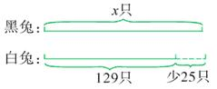

# Mathematics (Grade 6)

**ID**: a82e2d91
**难度**: medium_easy
**题型**: short_answer

## 题目
看图列方程并解答。

## 解答

**答案**: 154

1. Step1:根据图可知白兔比黑兔少25只，黑兔有x只，白兔有129只，可列方程x - 25 = 129
2. Step2:求解方程x - 25 = 129，方程两边同时加25，得到x = 129 + 25
3. Step3:计算129 + 25的结果为154，所以x = 154
4. Step4:题目要求的答案是x的值，即154，将其作为列表元素，得到['154']

## 知识点

**知识点**:
  - 

---
