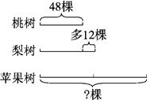

# Mathematics (Grade 6)

**ID**: b61b1c17
**难度**: medium_easy
**题型**: short_answer

## 题目
看图列式计算。

______________________________

## 解答

**答案**: 48+12=60(棵), 60*2=120(棵)

1. Step1:从图中可知梨树比桃树多12棵，桃树有48棵，所以先计算梨树的棵数，用桃树的棵数48加上多的12棵，即48 + 12 = 60(棵)
2. Step2:又因为苹果树的棵数是梨树的2倍，所以计算苹果树的棵数，用梨树的棵数60乘以2，即60 * 2 = 120(棵)

## 知识点

**知识点**:
  - 小学数学;数与代数;应用题;复合应用题

---
