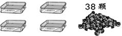

# Mathematics (Grade 6)

**ID**: e5ad6e87
**难度**: medium_easy
**题型**: short_answer

## 题目

每盒装9颗，4盒能装下吗？（先列式计算，再在正确的答案后面画“√”）
□○□=□（  ）
能□ 不能□

## 解答

**答案**: 不能

1. Step1:根据每盒装9颗，有4盒，用乘法计算4盒一共能装的颗数，即9×4=36（颗）
2. Step2:已知总共有38颗，将4盒能装的36颗与38颗比较，36＜38
3. Step3:得出4盒不能装下38颗的结论

## 知识点

**知识点**:
  - 小学数学;数与代数;应用题;简单应用题;整数简单应用题

---
