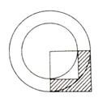

# Mathematics (Grade 6)

**ID**: f2c6f139
**难度**: medium_easy
**题型**: short_answer

## 题目
如下图，已知阴影部分的面积是15平方厘米，求环形的面积．

## 解答

**答案**: 47.1平方厘米

1. Step1:设大圆半径为R，小圆半径为r。
2. Step2:可知阴影部分面积 = 大正方形面积 - 小正方形面积，大正方形边长为R，小正方形边长为r，所以阴影部分面积 = R² - r²，又已知阴影部分面积是15平方厘米，即R² - r² = 15平方厘米。
3. Step3:环形面积公式为S = πR² - πr² = π(R² - r²)。
4. Step4:把R² - r² = 15平方厘米代入环形面积公式，可得环形面积 = 3.14×15 = 47.1平方厘米。

## 知识点

**知识点**:
  - 小学数学;图形与几何;平面图形;圆;圆环的面积

---
