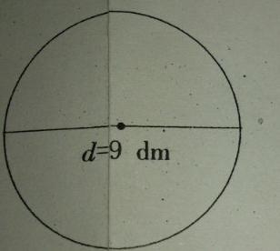

# Mathematics (Grade 6)

**ID**: f5c97364
**难度**: medium_easy
**题型**: short_answer

## 题目
求下图周长．

 d=9dm

## 解答

**答案**: 28.26

1. Step1:明确圆的周长公式为c = πd，其中c表示圆的周长，d表示圆的直径，π通常取3.14。
2. Step2:已知圆的直径d = 9dm，将d = 9dm和π = 3.14代入公式c = πd，得到c = 3.14×9。
3. Step3:计算3.14×9的结果为28.26dm，即圆的周长为28.26dm。

## 知识点

**知识点**:
  - --

---
