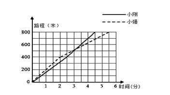

# Mathematics (Grade 6)

**ID**: 02785aed
**难度**: medium
**题型**: fill_in_the_blank

## 题目
小刚和小强赛跑情况如下图。
         
（1）（____________）先到达终点；
（2）比赛中，先快后慢的是（____________）；
（3）小刚的平均速度约是（_________）米/分（得数保留一位小数）。

## 解答

**答案**: 小刚, 小强, 177.8

1. Step1:观察赛跑情况图，在相同的800米路程中，小刚所用时间比小强少，所以先到达终点的是小刚
2. Step2:从图中可以看出小强一开始速度较快，后面速度变慢，所以先快后慢的是小强
3. Step3:根据速度 = 路程÷时间，小刚跑800米用了4.5分钟，800÷4.5≈177.8（米/分），所以小刚的平均速度约是177.8米/分

## 知识点

**知识点**:
  - 小学数学;统计和概率;统计;统计图表的综合应用

---
