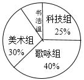

# Mathematics (Grade 6)

**ID**: 0346bc62
**难度**: medium
**题型**: fill_in_the_blank

## 题目
如图是六年级所有同学参加各种兴趣小组的统计图，每人只报一项，美术组有60人，全年级有（_______）人；歌咏组有（_______）人；书法组占全年级人数的（_______）%;美术组比歌咏组的人数少（_______）%

## 解答

**答案**: 200, 80, 5, 25

1. Step1:已知美术组有60人，占全年级人数的30%，根据“已知部分量和部分量占总量的百分比求总量用除法”，可得全年级人数为60÷30% = 200人
2. Step2:已知全年级有200人，歌咏组占全年级人数的40%，根据“求一个数的百分之几是多少用乘法”，可得歌咏组人数为200×40% = 80人
3. Step3:因为全年级人数看作单位“1”，用1减去美术组、科技组、歌咏组所占百分比，即1 - 30% - 25% - 40% = 5%，得到书法组占全年级人数的5%
4. Step4:先求出美术组比歌咏组少的人数为80 - 60 = 20人，再根据“求一个数比另一个数少百分之几，用少的量除以另一个数”，可得美术组比歌咏组人数少的百分比为(80 - 60)÷80×100% = 25%

## 知识点

**知识点**:
  - 小学数学;统计和概率;统计;统计图;扇形统计图的特点及绘制

---
