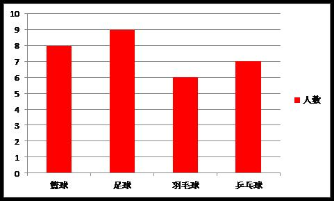

# Mathematics (Grade 6)

**ID**: 0c16a920
**难度**: medium
**题型**: fill_in_the_blank

## 题目
观察条形统计图，回答下列问题。

（1）喜欢足球的比喜欢羽毛球的多（______）。
（2）图中每格代笔（______）人。
（3）喜欢（______）项目的人数最少。

## 解答

**答案**: 31, 羽毛球, 项目的人数最少

1. Step1:从图中可知喜欢足球的人数为9人，喜欢羽毛球的人数为6人，计算喜欢足球的比喜欢羽毛球多的人数，即9 - 6 = 3人
2. Step2:观察统计图纵轴，相邻两个刻度之间差值为1，所以每格代表1人
3. Step3:比较喜欢篮球（8人）、足球（9人）、羽毛球（6人）、乒乓球（7人）的人数，6＜7＜8＜9，得出喜欢羽毛球项目的人数最少

## 知识点

**知识点**:
  - 小学数学;统计和概率;统计;统计图

---
