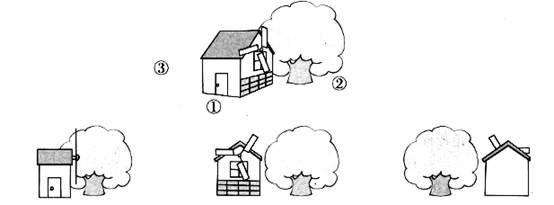

# Mathematics (Grade 6)

**ID**: 11ab54ba
**难度**: medium
**题型**: fill_in_the_blank

## 题目
认真观察，操作实践。
以下3幅图分别是从哪个位置看到的？(填序号)

（_____）                   （______）                    （_____）

## 解答

**答案**: ①, ②, ③

1. Step1:观察第一幅图，房子在树的左侧，烟囱在右侧，对比给定的三个位置，只有从①位置看过去是这种情况，所以第一幅图是从①位置看到的
2. Step2:观察第二幅图，树在房子的左侧，对比给定的三个位置，从②位置看过去符合这种情况，所以第二幅图是从②位置看到的
3. Step3:观察第三幅图，房子在树的右侧，烟囱在左侧，对比给定的三个位置，从③位置看过去是这种情况，所以第三幅图是从③位置看到的

## 知识点

**知识点**:
  - 小学数学;图形与几何;立体图形;观察物体

---
