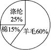

# Mathematics (Grade 6)

**ID**: 158f41e5
**难度**: medium
**题型**: fill_in_the_blank

## 题目
右图是一件毛衣各种成分的统计图，这件毛衣的含棉量是（____）%，涤纶的含量比羊毛的含量少总量的（____）%。如果这件毛衣重500 g，羊毛有（_____）g，棉有（____）g。

## 解答

**答案**: 15, 35, 300, 75

1. Step1:从统计图中可直接看出这件毛衣的含棉量是15%
2. Step2:计算涤纶的含量比羊毛的含量少总量的百分比，用羊毛的含量60%减去涤纶的含量25%，即60 - 25 = 35%
3. Step3:已知毛衣重500g，计算羊毛的重量，用毛衣总重量乘以羊毛的含量，即500×60% = 300g
4. Step4:已知毛衣重500g，计算棉的重量，用毛衣总重量乘以棉的含量，即500×15% = 75g

## 知识点

**知识点**:
  - 小学数学;统计和概率;统计;统计图

---
