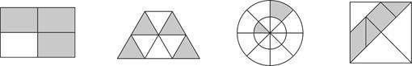

# Mathematics (Grade 6)

**ID**: 15c74740
**难度**: medium
**题型**: fill_in_the_blank

## 题目
用百分数表示下图中的涂色部分。

(   )                   (   )                (   )               (   )

## 解答

**答案**: 75%, 50%, 12.5%, 37.5%

1. Step1:第一个图形被平均分成8份，涂色部分是6份，6÷8 = 0.75，转化为百分数是75%
2. Step2:第二个图形被平均分成2份，涂色部分是1份，1÷2 = 0.5，转化为百分数是50%
3. Step3:第三个图形被平均分成8份，涂色部分是1份，1÷8 = 0.125，转化为百分数是12.5%
4. Step4:第四个图形被平均分成8份，涂色部分是3份，3÷8 = 0.375，转化为百分数是37.5%

## 知识点

**知识点**:
  - 

---
