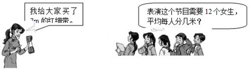

# Mathematics (Grade 6)

**ID**: 1a463198
**难度**: medium
**题型**: fill_in_the_blank

## 题目

## 解答

**答案**: $\frac{7}{12}$

1. Step1:明确问题是求把7米红绸带平均分给12个女生，每人分得的长度
2. Step2:根据除法的意义，把一个数平均分成几份，求每份是多少用除法计算，所以用红绸带的总长度7米除以女生的人数12人
3. Step3:计算7÷12的结果为$rac{7}{12}$米，即平均每人分$rac{7}{12}$米

## 知识点

**知识点**:
  - 分数除法应用题

---
