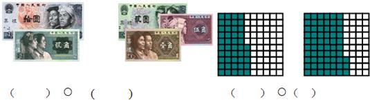

# Mathematics (Grade 6)

**ID**: 1dbae55a
**难度**: medium
**题型**: fill_in_the_blank

## 题目
看图，先写小数，再比较大小．

## 解答

**答案**: 10.20, 2.60, 45/100, 63/100

1. Step1:观察左边人民币，10元加上2角，2角 = 0.2元，所以写作小数是10.20元
2. Step2:观察右边人民币，2元加上6角，6角 = 0.6元，所以写作小数是2.60元
3. Step3:观察左边方格图，把单位“1”平均分成100份，涂色部分是45份，即45/100，化成小数是0.45
4. Step4:观察右边方格图，把单位“1”平均分成100份，涂色部分是63份，即63/100

## 知识点

**知识点**:
  - 小数的读写、意义及分类．

---
