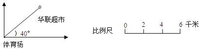

# Mathematics (Grade 6)

**ID**: 217d6a97
**难度**: medium
**题型**: fill_in_the_blank

## 题目
华联超市在体育场的(     )偏(     )°方向(     )千米处．

## 解答

**答案**: 东, 北40, 6

1. Step1:根据地图方向规则，上北下南，左西右东，以体育场为观察点确定方向
2. Step2:经测量得出华联超市到体育场的图上距离是3厘米
3. Step3:由比例尺可知图上1厘米代表实际距离2千米，计算实际距离为2×3 = 6千米
4. Step4:得出华联超市在体育场的东偏北40°方向6千米处

## 知识点

**知识点**:
  - 根据方向和距离确定物体的位置

---
