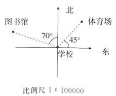

# Mathematics (Grade 6)

**ID**: 228717ad
**难度**: medium
**题型**: fill_in_the_blank

## 题目

（1）体育场在学校的________方向，距学校大约________千米。   
（2）图书馆在学校的________方向，距学校大约________千米。

## 解答

**答案**: 东偏北45°, 1.7, 北偏西70°, 2.2

1. Step1:根据图中体育场与学校的位置关系，可知体育场在学校的东偏北45°方向
2. Step2:根据图中比例尺和体育场到学校的图上距离，通过测量和计算得出体育场距学校大约1.7千米
3. Step3:根据图中图书馆与学校的位置关系，可知图书馆在学校的北偏西70°方向
4. Step4:根据图中比例尺和图书馆到学校的图上距离，通过测量和计算得出图书馆距学校大约2.2千米

## 知识点

**知识点**:
  - 小学数学;图形与几何;位置与方向;根据方向、角度和距离确定物体的位置

---
