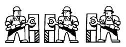

# Mathematics (Grade 6)

**ID**: 238a967f
**难度**: medium
**题型**: fill_in_the_blank

## 题目
三个工人共同生产了一批零件，甲完成了这批零件的28%，乙和丙完成零件个数的比是5∶4，又知甲、乙一共生产68个零件，这批零件一共有________个．

## 解答

**答案**: 100

1. Step1:先求出乙和丙完成零件数占这批零件总数的比例，因为甲完成了28%，所以乙和丙完成的比例为1 - 28% = 72%。
2. Step2:根据乙和丙完成零件个数的比是5∶4，计算出乙完成零件数占乙和丙完成总数的比例，为5÷(5 + 4)=5/9。
3. Step3:进而算出乙完成零件数占这批零件总数的比例，即72%×5/9 = 40%。
4. Step4:已知甲、乙一共生产68个零件，甲完成28%，乙完成40%，那么甲和乙完成的零件数占总数的28% + 40% = 68%。
5. Step5:因为甲、乙完成的零件数为68个，且占总数的68%，所以这批零件一共有68÷68% = 100个。

## 知识点

**知识点**:
  - 小学数学;数与代数;比和比例;比;比的应用

---
