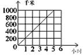

# Mathematics (Grade 6)

**ID**: 2684ccb3
**难度**: medium
**题型**: fill_in_the_blank

## 题目
一列动车在高速铁路上行驶的时间和路程如下图。看图填写：

（1）这列动车行800千米需要（_______）小时。
（2）这列动车行驶的时间和路程成（_______）比例。
（3）照这样计算，4.5小时行驶（_______）千米。

## 解答

**答案**: 4, 正, 900

1. Step1:观察图像，找到路程为800千米对应的时间，可得这列动车行800千米需要4小时
2. Step2:判断动车行驶的时间和路程的关系，由于路程与时间的比值（速度）一定，所以这列动车行驶的时间和路程成正比例
3. Step3:先根据图像得出速度为800÷4 = 200千米/小时，再计算4.5小时行驶的路程为200×4.5 = 900千米

## 知识点

**知识点**:
  - 小学数学;数与代数;比和比例;比例

---
