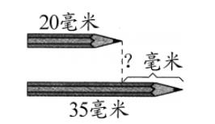

# Mathematics (Grade 6)

**ID**: 3149e81a
**难度**: medium
**题型**: fill_in_the_blank

## 题目
上面的铅笔比下面的铅笔多多少毫米？

## 解答

**答案**: 15

1. Step1:明确问题是求上面的铅笔比下面的铅笔少多少毫米
2. Step2:根据图片信息得出下面铅笔长35毫米，上面铅笔长20毫米
3. Step3:因为求一个数比另一个数少多少用减法计算，所以确定用35减去20来求解
4. Step4:计算35 - 20的结果为15毫米

## 知识点

**知识点**:
  - 整数的加法和减法;长度单位的认识、进率及换算

---
