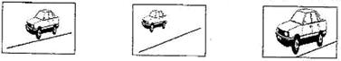

# Mathematics (Grade 6)

**ID**: 35c68e17
**难度**: medium
**题型**: fill_in_the_blank

## 题目
下午，爸爸开车来接欢欢放学，车从远处开来，按时间顺序给下面的三幅图编号。

（______）      （______）       （______）

## 解答

**答案**: 2, 1, 3

1. Step1:明确题目要求是按车从远处开来的时间顺序给三幅图编号
2. Step2:通常情况下，物体从远处开来时，距离越远看起来越小，距离越近看起来越大
3. Step3:观察三幅图，中间的图中车看起来最小，说明车距离最远，时间最早，应编号为1
4. Step4:左边的图中车比中间的图中车大，比右边的图中车小，说明车处于中间距离，时间处于中间，应编号为2
5. Step5:右边的图中车看起来最大，说明车距离最近，时间最晚，应编号为3

## 知识点

**知识点**:
  - 

---
