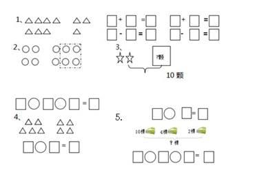

# Mathematics (Grade 6)

**ID**: 38448314
**难度**: medium
**题型**: fill_in_the_blank

## 题目
看图写算式

## 解答

**答案**: 7+3=10, 3+7=10, 10-7=3, 10-3=7, 4+6-4=6, 10-2=8, 5+4=9, 10+4+2=16

1. Step1:观察第一幅图，左边有7个三角形，右边有3个三角形，所以可列出加法算式7+3=10和3+7=10，还能列出减法算式10-7=3和10-3=7
2. Step2:观察第二幅图，左边有4个圆，右边有6个圆，且右边圈出4个圆，可列出算式4+6-4=6
3. Step3:观察第三幅图，一共有10颗星星，圈出2颗，可列出算式10-2=8
4. Step4:观察第四幅图，左边有5个三角形，右边有4个三角形，可列出算式5+4=9
5. Step5:观察第五幅图，有10根香蕉、4根黄瓜、2个茄子，可列出算式10+4+2=16

## 知识点

**知识点**:
  - 小学数学;数与代数;数的运算;整数的四则运算

---
